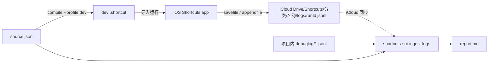

# shortcuts-kit

把 Apple 快捷指令当作源码来开发，并让 AI 帮你写。

- **`shortcuts-src`**：纯 Python 标准库写的命令行工具。它能在 iCloud 分享链接、`.shortcut` 文件和可编辑的 JSON / XML 源码之间做无损双向转换，可以签名编译，也能把 iOS 真机运行日志拉回 Mac 定位故障。
- **`apple-shortcuts` Skill**：一份通用的 Agent Skill（`SKILL.md`），可用于 Cursor、Claude Code、WorkBuddy 等工具。装上后，在任何项目里对 AI 说"帮我做一个快捷指令……"，它会按标准流程开发、验证、记录版本。
- **上游回流**：在其他项目里踩到工具缺陷或 iOS 平台坑时，AI 会启动子任务直接修复本仓库并提交 PR。经维护者审批合并后，所有项目都能用上修复。

> 整合了 [huangzhuxing/ShortcutSourceTool](https://github.com/huangzhuxing/ShortcutSourceTool) 的 iCloud 源码抽取思路、[0xdevalias 的 decompile-apple-shortcuts 笔记](https://gist.github.com/0xdevalias/27d9aea9529be7b6ce59055332a94477) 以及 [RoutineHub Shortcut Source Tool #5256](https://routinehub.co/shortcut/5256/) 的双向转换工作流。

---

## 目录

- [安装](#安装)
- [在 AI 工具里使用](#在-ai-工具里使用)
- [能力一览](#能力一览)
- [运行环境](#运行环境)
- [命令速查](#命令速查)
- [调试：Dev profile 日志回流](#调试dev-profile-日志回流)
- [产物与规范格式](#产物与规范格式)
- [作为 Python 库使用](#作为-python-库使用)
- [仓库结构](#仓库结构)
- [已知限制](#已知限制)
- [参与贡献](#参与贡献)
- [参考资料](#参考资料)

---

## 安装

```bash
git clone https://github.com/kylwao/shortcuts-kit.git
cd shortcuts-kit
scripts/install.sh
```

`install.sh` 做两件事：

1. 在 `~/.local/bin/` 生成 `shortcuts-src` 启动脚本，它直接运行本克隆里的 `src/`。之后 `git pull` 就等于升级，不需要 pip。如果 `~/.local/bin` 不在 `PATH` 里，脚本会提示怎么添加；也可以用 `SHORTCUTS_KIT_BIN=/usr/local/bin scripts/install.sh` 指定别的目录。
2. 把 `skills/apple-shortcuts` 软链接到本机已安装的 AI 工具的 skills 目录：

   | 工具 | 目录 |
   | --- | --- |
   | Cursor | `~/.cursor/skills/` |
   | Claude Code | `~/.claude/skills/` |
   | WorkBuddy | `~/.workbuddy/skills/` |

其他选项：`--no-cli`、`--no-skill`、`--uninstall`。

**只想用命令行工具、不需要 Skill 和回流**：

```bash
pip install "git+https://github.com/kylwao/shortcuts-kit"   # 需要较新的 pip（>= 21.3）
```

---

## 在 AI 工具里使用

装好之后，在任何项目里直接说需求即可，例如：

> 帮我做一个快捷指令：拍一张小票，用豆包识别金额和商户，记到备忘录"记账"文件夹里。

Skill 会引导 AI 完成以下步骤：

1. 自检 `shortcuts-src` 是否可用。
2. 确定起点：
   - 推荐：你先在 Shortcuts.app 里搭骨架，分享出 iCloud 链接，AI 再 `decompile` 得到源码；
   - 或者从 Skill 自带的空白模板开始。
3. 在项目的 `MyShortcuts/<分类>/V<x.y>/` 下编辑 `source.json`，用 `check` 和 `compile` 验证，更新 `VERSIONS.md`。
4. 需要真机调试时，用 `--profile dev` 编译，再用 `ingest-logs` 读回日志并定位到出错的动作。
5. 交给你的只有三件事：导入签名产物、在 App 里拷贝 iCloud 分享链接、首次运行时授权。

Skill 的完整规则见 [skills/apple-shortcuts/SKILL.md](skills/apple-shortcuts/SKILL.md)。已知的 iOS 平台坑见 [pitfalls.md](skills/apple-shortcuts/references/pitfalls.md)。

完整示例见 [examples/FoodAnalysis](examples/FoodAnalysis)「刚炫了啥」：462 个动作，用豆包识别食物照片，计算热量与营养素，写入 Apple Health 和日历，并用备忘录持久化常吃食物。

---

## 能力一览

| 能力 | 说明 |
| --- | --- |
| **iCloud 链接 → 源码** | 通过 CloudKit Records API 拉取未签名 bplist，转成 XML / JSON。 |
| **`.shortcut` 文件 → 源码** | 自动识别 AEA 自签名、裸 bplist、XML plist、本项目的规范 JSON；AEA 文件调用系统 `/usr/bin/aea` 解密。 |
| **源码 → `.shortcut` 文件** | 把 XML / JSON 转成 bplist，再交给系统 `/usr/bin/shortcuts sign` 生成可导入的签名文件。 |
| **无损往返** | `dict → bplist → dict` 字段顺序与 `UUID` 保持不变；JSON 里的二进制字节和日期用 sentinel key 承载。 |
| **Markdown 流程视图** | 几百步的长快捷指令也能一眼看完：带缩进的动作流程，长文本（注释、AI 提示词、用户提问）抽离到附录。 |
| **元数据摘要** | 最低 / 编写客户端版本、入口类型、输入类型、图标、动作数量等。 |
| **AI 快捷指令友好** | 识别豆包（`com.bot.doubao.AskAssistantIntent`）、ChatGPT 等常见第三方 Intent，提示词直接渲染在流程视图中。 |
| **Dev profile 遥测注入** | `compile --profile dev` 注入带 sentinel 标记的日志动作，iOS 运行时把每步记录写到 iCloud Drive。 |
| **日志聚合与失败定位** | `ingest-logs` 按 runId 聚合日志，把每步的 UUID 映射回 `source.json` 的动作下标和行号。 |
| **离线纯标准库** | 运行时零第三方依赖，只需 Python 3.7+ 和 macOS 自带的 `shortcuts` / `aea`。 |

---

## 运行环境

- **macOS 13+**：`/usr/bin/shortcuts` 负责签名，`/usr/bin/aea` 负责 AEA 解密。
- **Python 3.7+**：运行时无第三方依赖；测试需要 `pytest`。

非 macOS 环境只能使用 `decompile`（未签名 / XML / JSON 输入）和 `compile --allow-unsigned`。

---

## 命令速查

总入口：`shortcuts-src {decompile | compile | inspect | check | ingest-logs} ...`，每个子命令都支持 `-h`。

```bash
# iCloud 链接或 .shortcut → 源码四件套（source.json / source.xml / flow.md / meta.json）
shortcuts-src decompile "https://www.icloud.com/shortcuts/<32 位 hex>" -o out --name demo

# 只看摘要，不写文件
shortcuts-src inspect out/demo.source.json

# 编译前的结构校验：有 error 时退出码为 1
shortcuts-src check out/demo.source.json

# 源码 → 签名 .shortcut（--allow-unsigned 跳过签名，用于快速验证）
shortcuts-src compile out/demo.source.json -o out/demo.signed.shortcut
open -a Shortcuts out/demo.signed.shortcut
```

### `decompile`

| 参数 | 作用 |
| --- | --- |
| `INPUT` | iCloud 分享 URL，或本地 `.shortcut` / `.plist` / `.xml` / `.json` 文件。 |
| `-o, --out` | 输出目录。默认：URL 输入取当前目录，文件输入取该文件所在目录。 |
| `--format` | `xml` / `json` / `both`（默认）。 |
| `--name` | 覆盖输出文件前缀。 |
| `--no-flow` | 不生成 `flow.md`。 |
| `--keep-bplist` | 额外保留原始未签名 `.bplist`。 |

### `compile`

| 参数 | 作用 |
| --- | --- |
| `INPUT` | 编辑过的 `.json` / `.xml` / `.plist` 源码。 |
| `-o, --out` | 输出路径。默认 `<name>.signed.shortcut`（`--allow-unsigned` 时为 `.unsigned.shortcut`）。 |
| `--mode` | 签名模式：`anyone`（默认）或 `people-who-know-me`。 |
| `--keep-unsigned` | 同时保留中间的未签名 bplist。 |
| `--allow-unsigned` | 跳过签名，直接输出 bplist。 |
| `--profile` | `release`（默认）或 `dev`（注入遥测）。 |
| `--telemetry` | 遥测密度：`header-summary` / `branch`（默认）/ `full`，仅 `dev` 下生效。 |
| `--category` | 日志路径里的分类名。默认从输入路径的 `MyShortcuts/<分类>/` 推断。 |

### `check`

| 参数 | 作用 |
| --- | --- |
| `INPUT` | 同 `decompile`。`.json` / `.xml` 源码会在每条问题前标出动作所在行号。 |

每条问题一行，格式是 `<级别> #<动作下标> L<行号> <动作> [<代码>] <说明>`，最后一行是汇总。有 error 时退出码为 1，只有 warning 时为 0。

| 级别 | 代码 | 含义 |
| --- | --- | --- |
| error | `duplicate-uuid` | 两个动作的 `UUID` 相同（不区分大小写）。 |
| error | `unclosed-block` / `end-without-start` / `branch-outside-block` | 控制流块没有结束、没有开始，或分支不在任何块内。 |
| error | `interleaved-block` | 两个块交错，内层块还没结束外层块就分支或结束了。 |
| error | `identifier-mismatch` | 同一个 `GroupingIdentifier` 下动作 ID 不一致。 |
| error | `reused-grouping-id` / `missing-grouping-id` / `invalid-control-flow-mode` | `GroupingIdentifier` 被另一个块复用或缺失，或 `WFControlFlowMode` 不是整数 0 / 1 / 2。 |
| warning | `dangling-ref` | `ActionOutput` 引用的 `UUID` 不属于任何动作。Shortcuts.app 会在不起作用的字段里留下这种引用，确认该字段没在用就可以忽略。 |
| warning | `forward-ref` | 引用了自身或后面动作的输出。 |

### 输入识别

| 输入 | 识别方式 | 处理 |
| --- | --- | --- |
| `https://www.icloud.com/shortcuts/<32 hex>` | URL 正则 | CloudKit Records API → 下载未签名 bplist |
| 首 4 字节 `AEA1` | AEA 魔数 | `/usr/bin/aea decrypt`（仅自签名有效） |
| 首 8 字节 `bplist00` | 二进制 plist | `plistlib.loads` |
| `<?xml` 开头 | XML plist | `plistlib.loads` |
| `{` / `[` 开头 | 本项目规范 JSON | JSON 解码 + sentinel 还原 |

---

## 调试：Dev profile 日志回流

`--profile dev` 在编译时注入一串遥测动作。iOS 每次运行都会把 `runId`、时间戳、关键分支结果写成 JSONL 存到 iCloud Drive，同步回 Mac 后由 `ingest-logs` 聚合成带失败定位的 Markdown 报告。所有注入动作都带 `_ShortcutsSrcTelemetry` 标记，`decompile` 和 `ingest-logs` 会自动剥离。



```bash
shortcuts-src compile MyShortcuts/Demo/V0.1/demo.source.json --profile dev --telemetry branch
# 在 iPhone 上导入并运行几次，等待 iCloud 同步
shortcuts-src ingest-logs --source MyShortcuts/Demo/V0.1/demo.source.json -o MyShortcuts/Demo/V0.1/debuglog/report.md
```

| 遥测档位 | 新增动作数 | 适用 |
| --- | --- | --- |
| `header-summary` | 10 | 只想知道是否跑到终点 |
| `branch`（默认） | 10 + 2 × 分支点数 | 日常调试 |
| `full` | 10 + 2 × 原动作数 | 深度定位 |

iCloud 同步不便时，可以把 iPhone 上的 jsonl 通过 AirDrop 放到项目任意深度的 `debuglog/` 目录，`ingest-logs` 会自动发现。JSONL schema 与注入细节见 [docs/SHORTCUTS_DEVELOPMENT.md §16](docs/SHORTCUTS_DEVELOPMENT.md#16-运行期遥测与-ios--mac-日志回流)。

---

## 产物与规范格式

| 文件 | 作用 | 可编辑 |
| --- | --- | --- |
| `<name>.source.json` | 规范 JSON，字段顺序与 plist 一致 | 是（真源） |
| `<name>.source.xml` | 规范 XML plist，与 JSON 等价 | 是（真源） |
| `<name>.flow.md` | 流程视图 | 否 |
| `<name>.meta.json` | 元数据摘要 | 否 |

JSON 没有原生的 bytes 和 date 类型，约定两个 sentinel key：

| Python 值 | JSON 表示 |
| --- | --- |
| `bytes` | `{"__bplist_data_base64__": "<base64>"}` |
| `datetime` | `{"__bplist_date_iso__": "<ISO 8601>"}` |

签名产物 `*.signed.shortcut`、`*.bplist` 和调试日志都不要提交到 git。

---

## 作为 Python 库使用

```python
from shortcuts_src.decompile import decompile_input, inspect_input
from shortcuts_src.compile import compile_source
from shortcuts_src import plist_io
from shortcuts_src.flow import render_flow, extract_metadata
from shortcuts_src.icloud import fetch_unsigned_bplist

record, bplist_bytes = fetch_unsigned_bplist("https://www.icloud.com/shortcuts/<32 位 hex>")
shortcut = plist_io.loads(bplist_bytes)
print(record.name, len(shortcut["WFWorkflowActions"]))

out_path = compile_source("my.source.json", mode="anyone")
```

---

## 仓库结构

```
shortcuts-kit/
├── src/shortcuts_src/        # 命令行工具（零第三方依赖）
│   ├── cli.py  icloud.py  aea.py  plist_io.py
│   ├── decompile.py  compile.py  check.py  flow.py  names.py
│   └── profile.py  ingest.py # dev 遥测注入与日志聚合
├── tests/                    # pytest，含 examples 与 Skill 模板回归
├── skills/apple-shortcuts/   # Agent Skill
│   ├── SKILL.md
│   ├── references/           # rules / format / pitfalls / contributing-upstream
│   └── templates/            # 空白源码、VERSIONS.md、AI_PROMPTS.md
├── examples/FoodAnalysis/    # 完整示例（V0.7）
├── docs/SHORTCUTS_DEVELOPMENT.md  # 快捷指令开发资料手册
├── scripts/install.sh
└── .github/                  # CI、CODEOWNERS、PR / issue 模板
```

---

## 已知限制

1. **无法自动生成 iCloud 分享链接**：Apple 没有公开上传接口，链接必须在 Shortcuts.app 里手动「分享 → 拷贝 iCloud 链接」获得。
2. **Apple Gallery 官方签名不可解密**：请改用 iCloud 分享链接，工具会走未签名下载通道。
3. **签名依赖 macOS 13+**：非 macOS 环境只能 `--allow-unsigned`。
4. **`flow.md` 只读**：回编译始终以 `source.json` / `source.xml` 为准。
5. **动作名映射不完整**：`names.py` 约 70 条映射，未命中的动作 ID 原样显示，不影响正确性。

---

## 参与贡献

所有改动都通过 PR 进入 `main`，由维护者 [@kylwao](https://github.com/kylwao) 审批。

- 人工贡献：见 [CONTRIBUTING.md](CONTRIBUTING.md)。
- 在其他项目里由 AI 自动回流：见 [contributing-upstream.md](skills/apple-shortcuts/references/contributing-upstream.md)。
- 本地测试：`python3 -m pytest -q`。

---

## 参考资料

- [huangzhuxing/ShortcutSourceTool](https://github.com/huangzhuxing/ShortcutSourceTool)：Web 版源码抽取工具。
- [0xdevalias/decompile-apple-shortcuts.md](https://gist.github.com/0xdevalias/27d9aea9529be7b6ce59055332a94477)：反编译细节与 CloudKit 接口格式。
- [RoutineHub Shortcut Source Tool #5256](https://routinehub.co/shortcut/5256/)：在 Shortcuts.app 内完成类似能力的快捷指令。
- [sebj/iOS-Shortcuts-Reference](https://github.com/sebj/iOS-Shortcuts-Reference)：文件格式参考。
- [zachary7829: Deep Into Shortcuts — File Format](https://zachary7829.github.io/blog/shortcuts/fileformat)：`.shortcut` 与 `Shortcuts.sqlite` 分析。

## 许可

[MIT](LICENSE)
