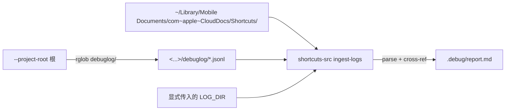
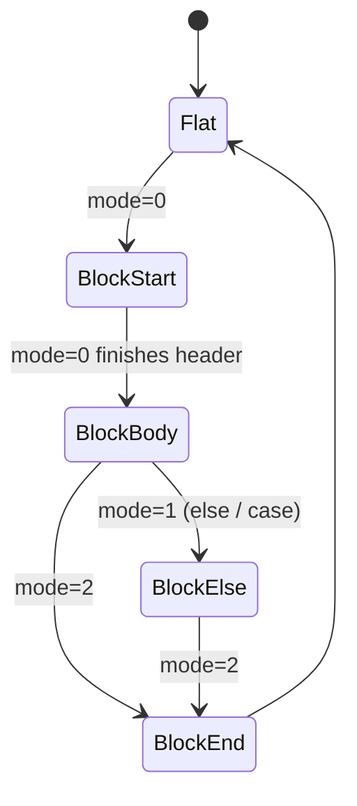

# Apple 快捷指令开发规范手册

> **面向：人类开发者与 AI 协作者**
> **定位：资料手册（facts / links / schemas）**，与 [Skill 规则](../skills/apple-shortcuts/references/rules.md)（AI Agent 硬规则）、[../README.md](../README.md)（工具用法）互补。
> **维护原则：** 本手册只沉淀事实性资料与链接；操作约束放 Skill 的 `rules.md`；平台坑放 Skill 的 `pitfalls.md`；工具用法放 `README.md`。
> **规则优先级：** 本手册与官方文档冲突时以官方为准，并回写修正；本手册与 `rules.md` 冲突时以 `rules.md` 为准。

---

## 目录

- [0. 总览与数据流](#0-总览与数据流)
- [1. iOS / macOS 版本与客户端编号对照](#1-ios--macos-版本与客户端编号对照)
- [2. `.shortcut` 文件格式](#2-shortcut-文件格式)
- [3. 动作标识符目录](#3-动作标识符目录)
- [4. 可调用 App 目录与 URL Scheme](#4-可调用-app-目录与-url-scheme)
- [5. macOS / iOS 系统级存储与数据库](#5-macos--ios-系统级存储与数据库)
- [6. iCloud 分享与 CloudKit Records API](#6-icloud-分享与-cloudkit-records-api)
- [7. CLI 工具速查](#7-cli-工具速查)
- [8. 权限、Entitlements 与首次运行陷阱](#8-权限entitlements-与首次运行陷阱)
- [9. App Intents 开发（iOS 16+）](#9-app-intents-开发ios-16)
- [10. HealthKit / SiriKit / WidgetKit 集成](#10-healthkit--sirikit--widgetkit-集成)
- [11. 调试 / 测试 / 反编译方法学](#11-调试--测试--反编译方法学)
- [12. 常见反模式与最佳实践](#12-常见反模式与最佳实践)
- [13. 设计与交互规范 (HIG)](#13-设计与交互规范-hig)
- [14. 官方文档索引](#14-官方文档索引)
- [15. 第三方资料索引](#15-第三方资料索引)
- [16. 运行期遥测与 iOS → Mac 日志回流](#16-运行期遥测与-ios--mac-日志回流)
- [附录 A：iOS 客户端版本号对照表](#附录-aios-客户端版本号对照表)
- [附录 B：控制流 Mode 状态机](#附录-b控制流-mode-状态机)
- [附录 C：本仓库 names.py 动作映射](#附录-c本仓库-namespy-动作映射)
- [附录 D：HealthKit 营养成分 ID 速查](#附录-dhealthkit-营养成分-id-速查)
- [附录 E：AI 协作提示词模板](#附录-eai-协作提示词模板)

---

## 0. 总览与数据流

```mermaid
flowchart TB
    subgraph Author [创作面]
        UI[Shortcuts.app] --> SqliteDB["~/Library/Shortcuts/Shortcuts.sqlite"]
        SqliteDB --> ICloudDocs["iCloud Mobile Documents"]
    end
    subgraph Distribute [分发面]
        UI -->|分享| ShareLink["icloud.com/shortcuts/id"]
        ShareLink -->|CloudKit Records API| Bplist["unsigned bplist"]
        ShareLink -->|signed| AEA["AEA1 .shortcut"]
    end
    subgraph DevLoop [开发面]
        Bplist -->|shortcuts-src decompile| Source["source.xml + source.json"]
        AEA -->|/usr/bin/aea decrypt| Bplist
        Source -->|shortcuts-src compile| Signed["signed .shortcut"]
        Signed -.Shortcuts.app 手动 Share.-> ShareLink
    end
```

三条等价来源最终汇聚到一个 Python `dict`：

- **iCloud 链接** → CloudKit Records API → unsigned `bplist` → `dict`
- **本地 `.shortcut`（AEA1）** → `/usr/bin/aea decrypt` → unsigned `bplist` → `dict`
- **本地 `bplist00` / XML plist / JSON 源** → `plistlib.loads` / 自解析 → `dict`

反方向统一走 `plistlib.dumps(FMT_BINARY)` → `/usr/bin/shortcuts sign`。

---

## 1. iOS / macOS 版本与客户端编号对照

`.shortcut` 头部有两个关键版本字段：

| 键 | 含义 |
| --- | --- |
| `WFWorkflowMinimumClientVersion` | 打开这条指令所需的 **最低** 客户端版本号（整数） |
| `WFWorkflowMinimumClientVersionString` | 同上的字符串表示（偶尔版本号为 `"900"` 这种约定值） |
| `WFWorkflowClientVersion` | **编写** 时所用的客户端版本号（用于识别新引入的字段） |

下表为经验映射（社区反推，Apple 不公开正式表）：

| iOS / macOS 版本 | 客户端版本号（近似） | 关键变化 |
| --- | --- | --- |
| iOS 12 | 469 – 750 | Workflow 更名为 Shortcuts；可直接 import 未签名 `.shortcut` |
| iOS 13 | 754 – 900 | 禁用 Files 直接 import，需要 iCloud 中转；`Shortcuts.realm` 存储 |
| iOS 14 | 900 – 1100 | 改用 `Shortcuts.sqlite`；Automation 上线 |
| iOS 15 | 1050 – 1450 | 引入 AEA 签名，`.shortcut` 变为 AEA1 封装；未签名不可导入 |
| iOS 16 / macOS 13 | 1510 – 2000 | **App Intents** 上线；macOS 开始自带 `Shortcuts.app` 与 `/usr/bin/shortcuts` CLI |
| iOS 17 / macOS 14 | 2400 – 3500 | App Intents 扩展（交互式 snippet、Siri 智能）；大量 `is.workflow.actions.intelligence.*` |
| iOS 18 / macOS 15 | 4000+ | Apple 智能（Apple Intelligence）集成；ChatGPT Intent 作为 built-in |

> 示例 `examples/FoodAnalysis` 对应 `minClient=3010 / client=4528.0.4.3`。

---

## 2. `.shortcut` 文件格式

### 2.1 顶层键

| 键 | 类型 | 说明 |
| --- | --- | --- |
| `WFWorkflowActions` | `Array<Action>` | 主体：动作列表 |
| `WFWorkflowIcon` | `Dict` | `{ WFWorkflowIconStartColor: UInt32, WFWorkflowIconGlyphNumber: Int }` |
| `WFWorkflowClientVersion` | `String` / `Int` | 编写客户端版本 |
| `WFWorkflowMinimumClientVersion` | `Int` | 最低可运行版本 |
| `WFWorkflowMinimumClientVersionString` | `String` | 同上字符串版 |
| `WFWorkflowTypes` | `[String]` | 入口类型（见下表） |
| `WFWorkflowInputContentItemClasses` | `[String]` | 分享表单输入允许的类型 |
| `WFWorkflowOutputContentItemClasses` | `[String]` | 输出类型 |
| `WFWorkflowImportQuestions` | `Array` | 导入时向用户提问（填值的位置） |
| `WFWorkflowHasOutputFallback` | `Bool` | 无输出时是否有 fallback 文本 |
| `WFWorkflowHasShortcutInputVariables` | `Bool` | 是否使用 Shortcut Input 魔法变量 |
| `WFQuickActionSurfaces` | `[String]` | `"WFQuickActionSurfaceTypeServicesMenu"` 等 |
| `WFWorkflowNoInputBehavior` | `Dict` | 没有输入时的行为 |

### 2.2 入口类型 (`WFWorkflowTypes`)

常见取值：

- `WFWorkflowTypeShowInSearch` — 出现在 Spotlight / Siri 建议
- `WFWorkflowTypeShareExtension` — 出现在分享表单
- `WFWorkflowTypeNCWidget` — 通知中心小组件
- `WFWorkflowTypeWatch` — Apple Watch
- `WFWorkflowTypeAutomation` — 自动化触发
- `WFWorkflowTypeReceivesOnScreenContent` — iOS 17+ 屏幕内容动作

### 2.3 单个 Action 的结构

```json
{
  "WFWorkflowActionIdentifier": "is.workflow.actions.setvariable",
  "WFWorkflowActionParameters": {
    "UUID": "8B4E1234-AAAA-4444-8888-0123456789AB",
    "WFVariableName": "TodayCalories",
    "WFInput": { "...": "Magic Variable / literal / nested structure" }
  }
}
```

- `UUID` 用于被后续动作的 `Variable` 引用，必须全局唯一；修改一条已有动作 **不要** 改它的 `UUID`。
- `GroupingIdentifier` 用于 `conditional` / `repeat` / `choosefrommenu` 的 start/else/end 三段式配对（同一块共享一个 UUID）。

### 2.4 控制流 (`WFControlFlowMode`)

| Mode | 含义 |
| --- | --- |
| `0` | 块的 **开始**（if / repeat / choose start） |
| `1` | 中间 **分支**（else、case）|
| `2` | 块的 **结束**（end if / end repeat） |

控制流配对依赖 `GroupingIdentifier`，不是靠顺序；即便两条 `if` 交错书写，匹配也按 UUID 还原。

### 2.5 变量引用（Magic Variables / Tokens）

变量引用用 `WFSerializationType` 区分：

| WFSerializationType | 含义 |
| --- | --- |
| `WFTextTokenString` | 整段字符串就是一个魔法变量 |
| `WFTextTokenAttachment` | 内嵌在字符串中的 `\uFFFC` 占位符，配合 `attachmentsByRange` 定位 |
| `WFNumberSubstitutableState` | 数字字段的「用变量替换」状态 |
| `WFDictionaryFieldValue` | 字典字段 |

典型 attachment 结构：

```json
{
  "Value": {
    "OutputUUID": "8B4E1234-AAAA-4444-8888-0123456789AB",
    "Type": "ActionOutput",
    "OutputName": "Variable"
  },
  "WFSerializationType": "WFTextTokenAttachment"
}
```

### 2.6 三种表示等价对照

| 层 | 格式 | 编辑友好度 | 本工具处理 |
| --- | --- | --- | --- |
| 系统原生 | binary plist（`bplist00`）| 差 | `plistlib` 直接读 |
| 可读规范 | XML plist | 中 | `plutil -convert xml1` / `plistlib` |
| 可读规范 | JSON（本项目约定 sentinel key） | 好 | `dump_json / loads` |

> JSON 里二进制字节用 `{"__bplist_data_base64__": "<b64>"}`，日期用 `{"__bplist_date_iso__": "<iso>"}` — 详见 [README §JSON 规范格式](../README.md)。

---

## 3. 动作标识符目录

动作分为两大命名空间：

1. **`is.workflow.actions.*`** — Apple 内置动作。
2. **`com.<vendor>.<app>.*`** — 第三方 App 通过 Intents / App Intents 暴露的动作。

### 3.1 Apple 内置动作（精选清单）

#### 变量与控制流

```
is.workflow.actions.setvariable
is.workflow.actions.getvariable
is.workflow.actions.appendvariable
is.workflow.actions.conditional
is.workflow.actions.choosefrommenu
is.workflow.actions.repeat.count
is.workflow.actions.repeat.each
is.workflow.actions.exit
is.workflow.actions.nothing
is.workflow.actions.delay
is.workflow.actions.waittoreturn
is.workflow.actions.runworkflow
```

#### 文本 / 数字 / 数学

```
is.workflow.actions.text
is.workflow.actions.gettext
is.workflow.actions.number
is.workflow.actions.math
is.workflow.actions.calculateexpression
is.workflow.actions.round
is.workflow.actions.statistics
is.workflow.actions.format.number
is.workflow.actions.text.combine
is.workflow.actions.text.split
is.workflow.actions.text.replace
is.workflow.actions.text.match
is.workflow.actions.count
```

#### 列表 / 字典

```
is.workflow.actions.list
is.workflow.actions.getitemfromlist
is.workflow.actions.dictionary
is.workflow.actions.getvalueforkey
is.workflow.actions.setvalueforkey
is.workflow.actions.detect.dictionary
```

#### 日期 / 日历

```
is.workflow.actions.date
is.workflow.actions.adjustdate
is.workflow.actions.gettimebetweendates
is.workflow.actions.format.date
is.workflow.actions.addnewevent
is.workflow.actions.addnewreminder
```

#### 文件 / URL / 网络

```
is.workflow.actions.url
is.workflow.actions.downloadurl
is.workflow.actions.openurl
is.workflow.actions.openx-callback
is.workflow.actions.getheadersfromurl
is.workflow.actions.getcomponentsofurl
is.workflow.actions.getfile
is.workflow.actions.savefile
is.workflow.actions.appendfile
```

#### 媒体

```
is.workflow.actions.takephoto
is.workflow.actions.selectphoto
is.workflow.actions.recordvideo
is.workflow.actions.recordaudio
is.workflow.actions.properties.images
is.workflow.actions.savetophotoalbum
is.workflow.actions.qrcode.generate
is.workflow.actions.detect.qrcode
```

#### 健康

```
is.workflow.actions.filter.health.quantity
is.workflow.actions.health.quantity.log
is.workflow.actions.filter.health.category
is.workflow.actions.health.workout.log
```

#### UI / 输入输出

```
is.workflow.actions.ask
is.workflow.actions.alert
is.workflow.actions.showresult
is.workflow.actions.notification
is.workflow.actions.speak
is.workflow.actions.dictate
```

#### 剪贴板 / 分享

```
is.workflow.actions.share
is.workflow.actions.copytoclipboard
is.workflow.actions.getclipboard
```

#### 脚本 / 高级

```
is.workflow.actions.runjavascript
is.workflow.actions.runjavascriptonwebpage
is.workflow.actions.comment
```

> 完整的内置动作名表较长（200+ 条），实际使用时以 `shortcuts-src decompile` 输出为准，或查 [sebj/iOS-Shortcuts-Reference](https://github.com/sebj/iOS-Shortcuts-Reference)。

### 3.2 第三方 Intent 命名空间速查

| 命名空间前缀 | 所属 App | 备注 |
| --- | --- | --- |
| `com.bot.doubao.*` | 豆包（字节跳动） | `AskAssistantIntent` 为默认 AI 问答入口 |
| `com.openai.chat.*` | ChatGPT | `ChatGPTIntent` 等 |
| `com.apple.intelligence.*` | Apple Intelligence | iOS 18+ 内置，含 ChatGPT 代理 |
| `com.anthropic.claude.*` | Claude | 视版本可能为 `com.anthropic.claudeforios.*` |
| `com.google.Gemini.*` | Google Gemini | |
| `com.microsoft.copilot.*` | Microsoft Copilot | |
| `com.automattic.wordpress.*` | WordPress | |
| `com.runestone.RunestoneActions.*` | Runestone (代码编辑器) | |
| `com.toolbox-pro.toolbox.*` | Toolbox Pro | 大量扩展内置动作能力 |
| `com.thunkable.*` | Thunkable | |
| `com.omnigroup.OmniFocus3.*` | OmniFocus | |
| `com.tapbots.Ivory.*` | Ivory (Mastodon) | |
| `dk.simonbs.Scriptable.*` | Scriptable | `RunScriptIntent` 运行 JS |
| `com.agiletortoise.Drafts5.*` | Drafts | |
| `com.readdle.smartemail.*` | Spark | |

第三方 App 真正暴露哪些 intent，取决于其 `Info.plist` 中的 `NSUserActivityTypes` / `INIntentsSupported` 以及 App Intents 声明。**本地查询**最准的方法是在 `Shortcuts.app` 搜索框输入 App 名。

---

## 4. 可调用 App 目录与 URL Scheme

### 4.1 常见系统 Bundle ID

| Bundle ID | App |
| --- | --- |
| `com.apple.shortcuts` | 快捷指令 |
| `com.apple.mobilesafari` | Safari |
| `com.apple.MobileSMS` | 信息 |
| `com.apple.mobilemail` | 邮件 |
| `com.apple.mobilephone` | 电话 |
| `com.apple.Preferences` | 设置 |
| `com.apple.Health` | 健康 |
| `com.apple.mobilecal` | 日历 |
| `com.apple.reminders` | 提醒事项 |
| `com.apple.mobilenotes` | 备忘录 |
| `com.apple.Maps` | 地图 |
| `com.apple.camera` | 相机 |
| `com.apple.mobileslideshow` | 照片 |
| `com.apple.Music` | 音乐 |
| `com.apple.podcasts` | 播客 |
| `com.apple.calculator` | 计算器 |
| `com.apple.weather` | 天气 |

### 4.2 第三方 Bundle ID 查询方法

浏览器访问（把 `bundleId` 参数替换成你要查的）：

```
https://itunes.apple.com/lookup?bundleId=com.tencent.xin
```

返回 JSON 中 `trackName` 即 App 名、`trackId` 为 App Store ID、`version` 为版本号。若 `resultCount=0`，说明该 App 不在 App Store 或 Bundle ID 错了。

反向查 Bundle ID（按 App 名）：

```
https://itunes.apple.com/search?term=微信&entity=software&country=cn&limit=3
```

### 4.3 `x-callback-url` 调用约定

格式：

```
scheme://[host]/action?[param1=value1&...]
  &x-success=<调用方 scheme>
  &x-error=<调用方 scheme>
  &x-cancel=<调用方 scheme>
```

使用 `is.workflow.actions.openx-callback`（Shortcuts 里叫 **打开 X-Callback URL**）而不是 `openurl`，它会等待目标 App 回调再继续。

### 4.4 设置 (Settings) 深链

格式：`App-prefs:root=<Section>[&path=<Subpath>]`。部分示例：

| URL | 位置 |
| --- | --- |
| `App-prefs:root=WIFI` | Wi-Fi |
| `App-prefs:root=Bluetooth` | 蓝牙 |
| `App-prefs:root=Notifications` | 通知 |
| `App-prefs:root=DISPLAY` | 显示与亮度 |
| `App-prefs:root=Privacy&path=HEALTH` | 隐私 → 健康 |
| `App-prefs:root=CASTLE` | iCloud |
| `App-prefs:root=General&path=About` | 关于本机 |

> iOS 不再公开完整列表，社区维护的权威参考是 [FifiTheBulldog/ios-settings-urls](https://github.com/FifiTheBulldog/ios-settings-urls)。

### 4.5 常用第三方 Scheme 示例

| Scheme | App |
| --- | --- |
| `weixin://` | 微信 |
| `alipay://` / `alipays://` | 支付宝 |
| `mqq://` / `mqqapi://` | QQ |
| `taobao://` / `tbopen://` | 淘宝 |
| `drafts://` | Drafts |
| `omnifocus://` | OmniFocus |
| `workflow://` / `shortcuts://` | Shortcuts 自身 |
| `scriptable:///run?...` | Scriptable |
| `things:///add?title=...` | Things 3 |

---

## 5. macOS / iOS 系统级存储与数据库

### 5.1 主数据库

macOS 14.x 实测路径（由 0xdevalias gist 的 `sqlite3` 调查所得）：

```
~/Library/Shortcuts/Shortcuts.sqlite
~/Library/Shortcuts/Shortcuts.sqlite-wal
~/Library/Shortcuts/Shortcuts.sqlite-shm
~/Library/Shortcuts/SecuredPreferences.plist
~/Library/Shortcuts/ShareSheetState.plist
~/Library/Shortcuts/Spotlight.dat
~/Library/Shortcuts/Temporary/                # 沙盒临时目录
```

iOS：`/var/mobile/Library/Shortcuts/Shortcuts.sqlite`（iOS 14+；iOS 13 为 `.realm`）。

### 5.2 核心表

| 表 | 作用 |
| --- | --- |
| `ZSHORTCUT` | 每条指令（名称、UUID、动作计数、客户端版本） |
| `ZSHORTCUTACTIONS` | 动作 bplist（`ZDATA` 列是二进制 plist） |
| `ZTRIGGER` | 自动化触发器 |
| `ZTRIGGEREVENT` | 触发事件 |
| `ZCOLLECTION` | 文件夹 |
| `ZLIBRARY` | 库元信息 |
| `ZSHORTCUTICON` | 图标 |
| `ZSHORTCUTBOOKMARK` | 安全作用域书签 |
| `ZSHORTCUTQUARANTINE` | 隔离状态 |
| `ZACCESSRESOURCEPERMISSION` | 权限记录（健康 / 位置等） |

### 5.3 `ZSHORTCUT` 常用列

| 列 | 含义 |
| --- | --- |
| `ZNAME` | 指令名称 |
| `ZWORKFLOWID` | 全局 UUID |
| `ZACTIONS` | 关联 `ZSHORTCUTACTIONS.Z_PK` |
| `ZACTIONCOUNT` | 动作数 |
| `ZTRIGGERCOUNT` | 自动化触发数 |
| `ZMINIMUMCLIENTVERSION` | 最低客户端版本字符串 |
| `ZWORKFLOWSUBTITLE` | 副标题（"5 actions"） |
| `ZCREATIONDATE` / `ZMODIFICATIONDATE` | 时间戳 |

### 5.4 只读导出示例

```bash
sqlite3 -readonly -json ~/Library/Shortcuts/Shortcuts.sqlite \
  "SELECT Z_PK, ZNAME, ZWORKFLOWSUBTITLE, ZACTIONCOUNT, ZWORKFLOWID \
   FROM ZSHORTCUT;"
```

联合解 `ZDATA`（bplist）：

```bash
sqlite3 -readonly -json ~/Library/Shortcuts/Shortcuts.sqlite "
  SELECT ZSHORTCUT.ZNAME, hex(ZSHORTCUTACTIONS.ZDATA) AS HEX
  FROM ZSHORTCUT LEFT JOIN ZSHORTCUTACTIONS
    ON ZSHORTCUT.ZACTIONS = ZSHORTCUTACTIONS.Z_PK;" | \
python3 -c "
import sys, json, plistlib, binascii
for row in json.load(sys.stdin):
    if row.get('HEX'):
        row['ACTIONS'] = plistlib.loads(binascii.unhexlify(row['HEX']))
        del row['HEX']
    print(row['ZNAME'], '→', len(row.get('ACTIONS', [])), 'actions')
"
```

> **警告：** 永远以 `-readonly` 打开；直接写 `Shortcuts.sqlite` 会破坏 Core Data 一致性并可能被 CloudKit 回滚。

### 5.5 iCloud 同步路径

```
~/Library/Mobile Documents/iCloud~com~apple~shortcuts~runtime/
~/Library/Mobile Documents/iCloud~is~workflow~my~workflows/
```

macOS 14 实测这两个目录存在但内部通常为空（真正的数据在 Core Data）。

### 5.6 其它 Plist

- `~/Library/Preferences/com.apple.shortcuts.plist` — App 偏好设置（无实际指令数据）。
- `~/Library/Group Containers/group.com.apple.shortcuts/` — 组容器。

---

## 6. iCloud 分享与 CloudKit Records API

### 6.1 URL 格式

```
https://www.icloud.com/shortcuts/<32 位 hex record id>
```

### 6.2 CloudKit Records API

把 `/shortcuts/` 替换为 `/shortcuts/api/records/`，返回 JSON：

```json
{
  "recordName": "01234567-89AB-CDEF-0123-456789ABCDEF",
  "fields": {
    "name":            { "value": "示例快捷指令" },
    "shortcut":        { "value": { "downloadURL": "https://cvws.icloud-content.com/...", "size": 38919, "fileChecksum": "..." } },
    "signedShortcut":  { "value": { "downloadURL": "https://cvws.icloud-content.com/..." } },
    "icon":            { "value": { "downloadURL": "...", "size": 42256 } },
    "signingStatus":   { "value": "APPROVED" },
    "signingCertificateExpirationDate": { "value": 1810236110000 }
  }
}
```

下载 `fields.shortcut.value.downloadURL` 得到 **未签名** 二进制 plist；下载 `fields.signedShortcut.value.downloadURL` 得到 AEA1 封装的签名版本。

### 6.3 AEA 签名模式

`/usr/bin/shortcuts sign --mode` 仅支持：

| 模式 | 对应 CloudKit 上的行为 |
| --- | --- |
| `anyone` | 任何人可导入；链接公开可分享 |
| `people-who-know-me` | 仅对分享者联系人可见 / 可导入 |

（Gallery / Apple 官方签名用的是不可逆的 Apple 证书链，无法本地签 / 解。）

### 6.4 硬限制：无法自动生成 iCloud 链接

Apple 没有公开的 CloudKit 上传接口。`compile` 产物只能在 `Shortcuts.app` 里手动「分享 → 拷贝链接」才能上传到 iCloud 并得到 `icloud.com/shortcuts/...` 链接。

> 理论上可用 `osascript` + UI Scripting 驱动 Shortcuts.app 做「半自动」闭环，但脆弱且 GUI-bound。

---

## 7. CLI 工具速查

### 7.1 `/usr/bin/shortcuts`（macOS 13+）

| 子命令 | 用途 |
| --- | --- |
| `shortcuts list` | 列出当前账号下所有指令 |
| `shortcuts list --folders` | 列出文件夹 |
| `shortcuts run "<名称>" [--input file] [--output file]` | 运行指令 |
| `shortcuts view "<名称>"` | 在 App 中打开查看 |
| `shortcuts sign --mode <mode> --input in --output out` | 签名 |

### 7.2 `/usr/bin/aea`（macOS 13+）

| 子命令 | 用途 |
| --- | --- |
| `aea encrypt -i in -o out -profile 0` | AEA 封装 |
| `aea decrypt -i in -o out` | AEA 拆封 |
| `aea sign -o archive` | 追加签名 |
| `aea id -i in` | 打印 archive id / profile |

**profile 速查：**

| Profile | 含义 |
| --- | --- |
| `0` | hkdf_sha256_hmac / none / ecdsa_p256（自签名、公开可分享） |
| `1` | 对称密钥 / none |
| `2–4` | 各种对称 + 非对称组合 |
| `5` | scrypt（密码派生） |

Shortcut 自签名用 profile 0。

### 7.3 `plutil`

| 命令 | 用途 |
| --- | --- |
| `plutil -convert xml1 -o out.xml in.plist` | 二进制 → XML |
| `plutil -convert json -o out.json in.plist` | 二进制 → JSON（无法表达 bytes/date，偶尔会报 `invalid object`） |
| `plutil -convert binary1 -o out.plist in.xml` | XML / JSON → 二进制 |
| `plutil -p in.plist` | 可读打印 |

### 7.4 `osascript` 驱动 Shortcuts.app（最小示例）

```applescript
tell application "Shortcuts Events"
  run shortcut "示例快捷指令" with input "hello"
end tell
```

或触发分享面板（UI scripting，脆弱）：

```applescript
tell application "Shortcuts" to activate
tell application "System Events"
  tell process "Shortcuts"
    click menu item "Share" of menu "File" of menu bar 1
  end tell
end tell
```

---

## 8. 权限、Entitlements 与首次运行陷阱

### 8.1 常见权限及 Info.plist key

| Info.plist Key | 含义 |
| --- | --- |
| `NSHealthShareUsageDescription` | 读取健康数据 |
| `NSHealthUpdateUsageDescription` | 写入健康数据 |
| `NSCameraUsageDescription` | 相机 |
| `NSPhotoLibraryUsageDescription` | 读取相册 |
| `NSPhotoLibraryAddUsageDescription` | 写入相册 |
| `NSLocationWhenInUseUsageDescription` | 使用期间定位 |
| `NSLocationAlwaysAndWhenInUseUsageDescription` | 始终定位 |
| `NSContactsUsageDescription` | 通讯录 |
| `NSCalendarsUsageDescription` | 日历 |
| `NSRemindersUsageDescription` | 提醒事项 |
| `NSMicrophoneUsageDescription` | 麦克风 |
| `NSAppleMusicUsageDescription` | Apple Music 媒体库 |
| `NSMotionUsageDescription` | 运动与健身 |
| `NSUserNotificationsUsageDescription` | 通知 |
| `NSLocalNetworkUsageDescription` | 本地网络 |
| `NSBluetoothAlwaysUsageDescription` | 蓝牙 |

### 8.2 Shortcut 首次运行陷阱

- 首次用到健康 / 日历 / 位置会弹「允许/拒绝」；拒绝后只能到 **设置 → 隐私与安全性 → 快捷指令** 里重新授权。
- 「敏感」动作（发邮件、删文件、涨跌通知、运行 JS、联网）每次都会弹「允许一次/总是允许」，除非快捷指令设了**总是允许**。
- 健康类指令若在「空库」首次运行会报 `no data`；通常建议在 Comment 里告知用户先在 **健康** App 手动写一条 0 值。
- Automation 类触发默认 **不** 自动运行，iOS 15+ 需用户勾选「运行时询问」为关闭。

### 8.3 Gallery 提交注意

- 只能通过 Apple Radar / Feedback Assistant 提交。
- 不得硬编码他人 UUID 或私有 API。
- 必须通过 Apple 签名才会显示为 "APPROVED"。

---

## 9. App Intents 开发（iOS 16+）

### 9.1 核心概念

| 类型 | 作用 |
| --- | --- |
| `AppIntent` | 一个可被 Shortcuts / Siri / Spotlight 调用的操作 |
| `AppShortcut` | 零配置曝光的快捷指令入口（App 一安装就出现在 Shortcuts 里） |
| `AppEnum` | 参数枚举（会渲染为下拉） |
| `AppEntity` | 结构化实体（可被后续步骤引用） |
| `IntentParameter` | 参数元数据（标题、默认值、查询器） |
| `DynamicOptionsProvider` | 动态候选值 |
| `IntentDialog` | 结果对话（语音 / 文字） |
| `ProvidesDialog` / `ShowsSnippetView` | 带 UI snippet 的返回 |

### 9.2 最小示例（Swift）

```swift
import AppIntents

struct LogMealIntent: AppIntent {
    static var title: LocalizedStringResource = "记录一餐"

    @Parameter(title: "卡路里 (kcal)")
    var calories: Double

    @Parameter(title: "餐型", default: .lunch)
    var kind: MealKind

    func perform() async throws -> some IntentResult & ProvidesDialog {
        try await HealthStore.shared.logCalories(calories)
        return .result(dialog: "已记录 \(Int(calories)) kcal \(kind.rawValue)")
    }
}

enum MealKind: String, AppEnum {
    case breakfast, lunch, dinner, snack
    static var typeDisplayRepresentation: TypeDisplayRepresentation = "餐型"
    static var caseDisplayRepresentations: [MealKind: DisplayRepresentation] = [
        .breakfast: "早餐", .lunch: "午餐", .dinner: "晚餐", .snack: "加餐",
    ]
}

struct BiteDanceShortcuts: AppShortcutsProvider {
    static var appShortcuts: [AppShortcut] {
        AppShortcut(intent: LogMealIntent(), phrases: [
            "用 \(.applicationName) 记录一餐"
        ], shortTitle: "记录一餐", systemImageName: "fork.knife")
    }
}
```

### 9.3 官方文档

- [App Intents Overview](https://developer.apple.com/documentation/appintents)
- [Making Your App's Functionality Available to Siri and Shortcuts](https://developer.apple.com/documentation/appintents/making-your-app-s-functionality-available-to-siri-and-short-cuts)
- [AppShortcuts WWDC 2022](https://developer.apple.com/videos/play/wwdc2022/10170/)

---

## 10. HealthKit / SiriKit / WidgetKit 集成

### 10.1 HealthKit

所有营养 / 运动数据都通过 `HKQuantityType` / `HKCategoryType` 读写。

- [HealthKit Overview](https://developer.apple.com/documentation/healthkit)
- [`HKQuantityTypeIdentifier`](https://developer.apple.com/documentation/healthkit/hkquantitytypeidentifier)

最小写入示例：

```swift
import HealthKit

let store = HKHealthStore()
let kcalType = HKQuantityType(.dietaryEnergyConsumed)
let sample = HKQuantitySample(
    type: kcalType,
    quantity: HKQuantity(unit: .kilocalorie(), doubleValue: 540),
    start: .now, end: .now
)
try await store.save(sample)
```

**授权请求：**

```swift
try await store.requestAuthorization(
  toShare: [HKQuantityType(.dietaryEnergyConsumed)],
  read:    [HKQuantityType(.dietaryEnergyConsumed),
            HKQuantityType(.activeEnergyBurned),
            HKQuantityType(.basalEnergyBurned)]
)
```

更多常量见 [附录 D](#附录-dhealthkit-营养成分-id-速查)。

### 10.2 SiriKit

- [SiriKit Overview](https://developer.apple.com/documentation/sirikit)
- iOS 16+ 推荐用 App Intents 替代 SiriKit Intents；SiriKit 仍用于媒体 / 通话 / 消息等系统域。

### 10.3 WidgetKit

- [WidgetKit Overview](https://developer.apple.com/documentation/widgetkit)
- iOS 17+ 支持交互式 widget，可以把 App Intent 作为按钮 action：

```swift
Button(intent: LogMealIntent()) {
    Label("记一餐", systemImage: "fork.knife")
}
```

---

## 11. 调试 / 测试 / 反编译方法学

### 11.1 使用本工具链

```bash
# 查看任意指令结构
shortcuts-src inspect <iCloud URL | 本地文件>

# 拆成源码（含 flow.md）
shortcuts-src decompile <input> -o out/

# 重编译并签名
shortcuts-src compile out/xxx.source.json -o rebuilt.shortcut
```

### 11.2 Console.app 日志

打开 **Console.app** → 设备 → 筛选 `subsystem:com.apple.shortcuts`，可以看到：

- 动作执行错误
- Intent 参数解析失败
- AEA 签名 / CloudKit 上传过程

### 11.3 Shortcuts.app 隐藏菜单

macOS 14+ 按住 Option 点击 **文件** 菜单，会露出 **View JSON…** / **Open with Editor…** 等开发者项。iOS 不提供类似入口。

### 11.4 反编译限制

- Gallery 官方签名的 AEA 不可解（密钥不归用户）。
- 自签名 AEA（anyone / people-who-know-me）可用 `/usr/bin/aea decrypt` 直接拆。
- 经 iOS 14 以前 `Get My Shortcuts` 导出的未签名 `.shortcut` 随时可拆（iOS 15+ 已不支持此动作）。

### 11.5 端到端 diff 测试

```bash
shortcuts-src decompile a.shortcut -o a
shortcuts-src decompile b.shortcut -o b
diff -u a/*.source.json b/*.source.json
```

JSON 字段顺序稳定，diff 易读。

---

## 12. 常见反模式与最佳实践

| 反模式 | 正确做法 |
| --- | --- |
| 直接改 `flow.md` 希望它被编译 | `flow.md` 只读；改 `source.json` / `source.xml` |
| 复制粘贴动作后手动改 `UUID` | 让 Shortcuts.app 重新生成；或用本工具 decompile 后保留原 UUID |
| 把密钥 / Token 硬编码在 Comment | 用 Keychain（iOS `is.workflow.actions.gettext` 配合环境不安全）或单独的 Prompt Input |
| 一条指令 200+ 步 | 拆成子指令 + `Run Shortcut`，便于单测 / 复用 |
| 依赖 `shortcuts://run-shortcut?name=` 跨设备 | 跨设备要求指令名完全一致；建议用 iCloud 链接 + Import |
| 把 `.signed.shortcut` 进 Git | `.gitignore` 掉；只入 source + meta + flow |
| 改完指令不写版本号 | 约定第一条 `Comment` 写 `vX.Y + 更新说明` |
| 在自动化里静默联网 | 给用户留 `ask` / `alert` 预览步骤 |
| 用 `Open URL` 做有返回值的跳转 | 用 `Open X-Callback URL`，它会等返回 |

---

## 13. 设计与交互规范 (HIG)

- [Human Interface Guidelines — Shortcuts](https://developer.apple.com/design/human-interface-guidelines/shortcuts)
- [Human Interface Guidelines — Siri](https://developer.apple.com/design/human-interface-guidelines/siri)
- [SF Symbols 官网](https://developer.apple.com/sf-symbols/) — 快捷指令图标命名空间，如 `fork.knife.circle` / `heart.fill` / `bolt`。

交互要点：

1. **弹窗最多 3 级**：动作内部弹窗不要连环套。
2. **只在关键节点提示成功/失败**：不要每步都 `showresult`。
3. **结果对话短**：`ProvidesDialog` 最好一句话，长内容用 snippet view。
4. **错误文案可操作**：告诉用户「要怎么做」，不是「发生了什么」。

---

## 14. 官方文档索引

### 核心框架

- [App Intents Framework](https://developer.apple.com/documentation/appintents)
- [Making Your App's Functionality Available to Siri and Shortcuts](https://developer.apple.com/documentation/appintents/making-your-app-s-functionality-available-to-siri-and-short-cuts)
- [SiriKit](https://developer.apple.com/documentation/sirikit)
- [WidgetKit](https://developer.apple.com/documentation/widgetkit)
- [HealthKit](https://developer.apple.com/documentation/healthkit)
- [`HKQuantityTypeIdentifier`](https://developer.apple.com/documentation/healthkit/hkquantitytypeidentifier)

### 系统与权限

- [Information Property List Key Reference](https://developer.apple.com/documentation/bundleresources/information_property_list)
- [SF Symbols](https://developer.apple.com/sf-symbols/)
- [App URL Schemes Guide](https://developer.apple.com/documentation/xcode/defining-a-custom-url-scheme-for-your-app)
- [AEA (Apple Encrypted Archive)](https://man.cameronkatri.com/macOS/aea)

### 用户手册

- [Shortcuts User Guide (iOS)](https://support.apple.com/guide/shortcuts/welcome/ios)
- [Shortcuts User Guide (macOS)](https://support.apple.com/guide/shortcuts-mac/welcome/mac)

### 设计规范

- [HIG — Shortcuts](https://developer.apple.com/design/human-interface-guidelines/shortcuts)
- [HIG — Siri](https://developer.apple.com/design/human-interface-guidelines/siri)

---

## 15. 第三方资料索引

### 格式与逆向

- [huangzhuxing/ShortcutSourceTool](https://github.com/huangzhuxing/ShortcutSourceTool) — 在线解析/转换 `.shortcut`。
- [0xdevalias/decompile-apple-shortcuts.md](https://gist.github.com/0xdevalias/27d9aea9529be7b6ce59055332a94477) — CloudKit 接口与 SQLite 结构分析。
- [sebj/iOS-Shortcuts-Reference](https://github.com/sebj/iOS-Shortcuts-Reference) — 文件格式参考。
- [zachary7829: Deep Into Shortcuts — File Format](https://zachary7829.github.io/blog/shortcuts/fileformat) — iOS 12–15 的存储差异。
- [joshfarrant/shortcuts-js](https://github.com/joshfarrant/shortcuts-js) — 用 JS 生成 iOS 12 Shortcuts。

### 目录 / 社区仓库

- [Shortcuts Directory](https://www.shortcuts.directory/) — 第三方 App 暴露的动作与 URL Scheme。
- [RoutineHub](https://routinehub.co/) — 大型指令共享站；可下载他人指令用于学习。
  - [Shortcut Source Tool #5256](https://routinehub.co/shortcut/5256/) — 同源参考。
- [MacStories Shortcuts Archive](https://www.macstories.net/shortcuts/) — 深度案例。
- [FifiTheBulldog/ios-settings-urls](https://github.com/FifiTheBulldog/ios-settings-urls) — 设置 URL 汇总。
- [LaunchCenterPro URL Database](https://launchcenterpro.com/gift-card-directory/) — 跨 App Scheme 总集。

### 工具

- [Dash](https://kapeli.com/dash) — 本地离线 Apple API 文档浏览。
- [iTunes Search API](https://itunes.apple.com/lookup?bundleId=com.tencent.xin) — 按 Bundle ID 反查 App 元信息。

---

## 16. 运行期遥测与 iOS → Mac 日志回流

本仓库工具链提供两条路把 iOS 运行期信息带回 Mac，供人/AI 诊断：

1. **iCloud Drive 自动同步**：dev profile 编译后的 shortcut 在 iOS 上用 `is.workflow.actions.savefile` / `appendfile` 把 JSONL 日志写到 `iCloud Drive/Shortcuts/<category>/<name>/logs/<runId>.jsonl`。Mac 上等 iCloud 同步（5–30s）后出现在 `~/Library/Mobile Documents/com~apple~CloudDocs/Shortcuts/`，`ingest-logs` 默认扫描此目录。首次可能需要 `brctl download <dir>` 把 Files On-Demand 占位符拉到本地（工具内部 best-effort 调用）。
2. **手动上传通道**：离线或企业网时，用 AirDrop / 邮件把 iOS `On My iPhone/Shortcuts/*.jsonl` 拿到 Mac，放到项目的 `MyShortcuts/<category>/<version>/debuglog/` 目录下。`ingest-logs` 在 `--project-root` 指定根下会递归发现任意深度的 `debuglog/` 目录并聚合。

### 注入点与 action 数学

`shortcuts-src compile --profile dev --telemetry <density>` 会调用 `src/shortcuts_src/profile.py::inject_dev_telemetry` 在源码的 `WFWorkflowActions` 前后插入遥测动作：

| 注入块 | 固定数量 | 作用 |
| --- | --- | --- |
| Header | 6 | `uuid` → `setvariable _ssrcRunId` → `date` → `format.date(ISO 8601)` → `gettext(header JSON)` → `savefile` 到 iCloud Drive |
| Summary | 4 | `date` → `format.date` → `gettext(summary JSON)` → `appendfile` |
| Checkpoint | 2 / 点 | `gettext(step JSON + 前一动作输出 attachment)` → `appendfile` |

三档密度预测：

| density | 新增动作数 |
| --- | --- |
| `header-summary` | `6 + 4 = 10` |
| `branch` (默认) | `10 + 2 × (分支点数)`；分支点 = `conditional`/`choosefrommenu`/`repeat.*` 的 start + `ask` + 所有 `com.*`（非 Apple）第三方 Intent |
| `full` | `10 + 2 × 原动作数` |

每个注入动作的 `WFWorkflowActionParameters` 带 `_ShortcutsSrcTelemetry` sentinel（取值形如 `header.uuid` / `step.appendfile` / `summary.gettext`），`strip_dev_telemetry` 按此 key 原样反注入。

### JSONL schema

```json
{"t":"header","runId":"<uuid>","name":"<shortcutName>","cat":"<category>","profile":"dev"}
{"t":"step","n":<int>,"id":"<action identifier>","uuid":"<action UUID>","ok":<bool>,"out":"<truncated 200 chars>","ts":"<ISO 8601>"}
{"t":"summary","ok":<bool>,"totalMs":<int?>}
```

- 若文件最后没有 `summary` 行：`ingest-logs` 判定为**异常终止**，记为 `aborted=true` + `firstFailStep = 最后一条 step.n + 1`。
- 若某条 `step.ok=false`：`firstFailStep` 直接取它的 `n`。

### 日志路径自动发现



支持的扩展名：`.jsonl` 与 `.log`。遇到同一文件多路径映射时按 `Path.resolve()` 去重。

### 诊断报告字段

`ingest-logs --source <source.json>` 时，每个 step 会被 **回溯** 为：

- `source_index` = 在 `WFWorkflowActions` 数组中的下标
- `source_line` = 在 `source.json` 纯文本中该 `"UUID": "..."` 出现的行号（基于正则扫描，不依赖 JSON 解析顺序）

AI 拿到报告后可以直接去 `source_line` 附近读若干行上下文，而不是全量加载 `source.json`。

---

## 附录 A：iOS 客户端版本号对照表

下表为本工具链与社区实测抽样整理，**非 Apple 官方文档**；实际取值可能略有浮动。

| `WFWorkflowMinimumClientVersion` | 大致对应 |
| --- | --- |
| `≤ 750` | iOS 12 |
| `754 – 898` | iOS 13 |
| `900 – 1050` | iOS 14 |
| `1070 – 1450` | iOS 15 |
| `1510 – 2050` | iOS 16 / macOS 13 |
| `2400 – 3500` | iOS 17 / macOS 14 |
| `4000 – 4500+` | iOS 18 / macOS 15 |

判定原则：打开指令时，App 会比对当前 `WFWorkflowClientVersion` 与 `WFWorkflowMinimumClientVersion`，若不足则提示「此快捷指令需要更高版本的 iOS」。

---

## 附录 B：控制流 Mode 状态机



实现建议（本工具 [flow.py](../src/shortcuts_src/flow.py) 采用）：

```python
indent = 0
for act in actions:
    mode = act["WFWorkflowActionParameters"].get("WFControlFlowMode")
    if mode == 2:
        indent -= 1          # dedent before print
    print("  " * max(0, indent - (mode == 1)) + render(act))
    if mode == 0:
        indent += 1          # indent after print
```

`mode == 1` 的「否则 / case」需要暂时回退一层缩进再恢复。

---

## 附录 C：本仓库 names.py 动作映射

以下为 [src/shortcuts_src/names.py](../src/shortcuts_src/names.py) 中目前收录的动作 ID → 中文短名映射（节选 70+ 条，实际以代码为准）：

| Identifier | 中文 |
| --- | --- |
| `is.workflow.actions.comment` | 注释 |
| `is.workflow.actions.number` | 数字 |
| `is.workflow.actions.text` / `.gettext` | 文本 |
| `is.workflow.actions.setvariable` | 设为变量 |
| `is.workflow.actions.getvariable` | 获取变量 |
| `is.workflow.actions.appendvariable` | 添加到变量 |
| `is.workflow.actions.conditional` | 如果 |
| `is.workflow.actions.repeat.count` | 重复 |
| `is.workflow.actions.repeat.each` | 遍历 |
| `is.workflow.actions.choosefrommenu` | 从菜单中选择 |
| `is.workflow.actions.exit` | 退出快捷指令 |
| `is.workflow.actions.waittoreturn` | 等待返回 |
| `is.workflow.actions.delay` | 延迟 |
| `is.workflow.actions.nothing` | 空操作 |
| `is.workflow.actions.math` | 计算 |
| `is.workflow.actions.calculateexpression` | 计算表达式 |
| `is.workflow.actions.round` | 四舍五入 |
| `is.workflow.actions.statistics` | 统计 |
| `is.workflow.actions.format.number` | 格式化数字 |
| `is.workflow.actions.format.date` | 格式化日期 |
| `is.workflow.actions.gettimebetweendates` | 两个日期之间 |
| `is.workflow.actions.text.combine` | 合并文本 |
| `is.workflow.actions.text.split` | 拆分文本 |
| `is.workflow.actions.text.replace` | 替换文本 |
| `is.workflow.actions.text.match` | 匹配文本 |
| `is.workflow.actions.getvalueforkey` | 获取字典值 |
| `is.workflow.actions.setvalueforkey` | 设置字典值 |
| `is.workflow.actions.detect.dictionary` | 从输入获取字典 |
| `is.workflow.actions.dictionary` | 字典 |
| `is.workflow.actions.list` | 列表 |
| `is.workflow.actions.getitemfromlist` | 获取列表中的项 |
| `is.workflow.actions.count` | 计数 |
| `is.workflow.actions.filter.health.quantity` | 查找健康样本 |
| `is.workflow.actions.health.quantity.log` | 记录健康样本 |
| `is.workflow.actions.ask` | 询问输入 |
| `is.workflow.actions.alert` | 显示提醒 |
| `is.workflow.actions.showresult` | 显示结果 |
| `is.workflow.actions.notification` | 显示通知 |
| `is.workflow.actions.speak` | 朗读文字 |
| `is.workflow.actions.takephoto` | 拍照 |
| `is.workflow.actions.selectphoto` | 选取照片 |
| `is.workflow.actions.properties.images` | 获取图像属性 |
| `is.workflow.actions.recordvideo` | 录制视频 |
| `is.workflow.actions.recordaudio` | 录制音频 |
| `is.workflow.actions.savetophotoalbum` | 存储到相簿 |
| `is.workflow.actions.getfile` | 获取文件 |
| `is.workflow.actions.savefile` | 存储文件 |
| `is.workflow.actions.appendfile` | 追加到文件 |
| `is.workflow.actions.url` | URL |
| `is.workflow.actions.downloadurl` | 获取 URL 内容 |
| `is.workflow.actions.openurl` | 打开 URL |
| `is.workflow.actions.openx-callback` | 打开 X-Callback URL |
| `is.workflow.actions.getheadersfromurl` | 获取 URL 标头 |
| `is.workflow.actions.getcomponentsofurl` | 获取 URL 的组件 |
| `is.workflow.actions.qrcode.generate` | 生成二维码 |
| `is.workflow.actions.detect.qrcode` | 扫描二维码 |
| `is.workflow.actions.addnewevent` | 添加日历事件 |
| `is.workflow.actions.addnewreminder` | 添加提醒事项 |
| `is.workflow.actions.adjustdate` | 调整日期 |
| `is.workflow.actions.date` | 日期 |
| `is.workflow.actions.share` | 共享 |
| `is.workflow.actions.copytoclipboard` | 拷贝到剪贴板 |
| `is.workflow.actions.getclipboard` | 获取剪贴板 |
| `is.workflow.actions.runjavascript` | 运行 JavaScript |
| `is.workflow.actions.runjavascriptonwebpage` | 在网页上运行 JavaScript |
| `is.workflow.actions.runworkflow` | 运行快捷指令 |
| `is.workflow.actions.dictate` | 听写文字 |
| `com.bot.doubao.AskAssistantIntent` | 豆包 AI 助手 |
| `com.openai.chat.ChatGPTIntent` | ChatGPT |
| `com.apple.intelligence.ChatGPTIntent` | Apple 智能 ChatGPT |

未命中的 identifier 会按原文展示（flow 渲染时）。新增条目请直接编辑 [names.py](../src/shortcuts_src/names.py) 并随 PR 一起更新此附录。

---

## 附录 D：HealthKit 营养成分 ID 速查

| 中文 | `HKQuantityTypeIdentifier` | 单位 |
| --- | --- | --- |
| 膳食能量 | `dietaryEnergyConsumed` | `kcal` |
| 蛋白质 | `dietaryProtein` | `g` |
| 碳水化合物 | `dietaryCarbohydrates` | `g` |
| 糖 | `dietarySugar` | `g` |
| 膳食纤维 | `dietaryFiber` | `g` |
| 脂肪总量 | `dietaryFatTotal` | `g` |
| 饱和脂肪 | `dietaryFatSaturated` | `g` |
| 单不饱和脂肪 | `dietaryFatMonounsaturated` | `g` |
| 多不饱和脂肪 | `dietaryFatPolyunsaturated` | `g` |
| 胆固醇 | `dietaryCholesterol` | `mg` |
| 钠 | `dietarySodium` | `mg` |
| 钾 | `dietaryPotassium` | `mg` |
| 钙 | `dietaryCalcium` | `mg` |
| 铁 | `dietaryIron` | `mg` |
| 镁 | `dietaryMagnesium` | `mg` |
| 锌 | `dietaryZinc` | `mg` |
| 维生素 A | `dietaryVitaminA` | `µg` |
| 维生素 C | `dietaryVitaminC` | `mg` |
| 维生素 D | `dietaryVitaminD` | `µg` |
| 维生素 E | `dietaryVitaminE` | `mg` |
| 维生素 B6 | `dietaryVitaminB6` | `mg` |
| 维生素 B12 | `dietaryVitaminB12` | `µg` |
| 叶酸 | `dietaryFolate` | `µg` |
| 咖啡因 | `dietaryCaffeine` | `mg` |
| 水 | `dietaryWater` | `mL` |

能量类（非膳食）：

| 中文 | `HKQuantityTypeIdentifier` |
| --- | --- |
| 活动能量 | `activeEnergyBurned` |
| 静息能量 | `basalEnergyBurned` |
| 步数 | `stepCount` |
| 距离 | `distanceWalkingRunning` |
| 心率 | `heartRate` |
| 血氧 | `oxygenSaturation` |
| 睡眠（分类型）| `HKCategoryTypeIdentifier.sleepAnalysis` |

完整列表见 [`HKQuantityTypeIdentifier`](https://developer.apple.com/documentation/healthkit/hkquantitytypeidentifier)。

---

## 附录 E：AI 协作提示词模板

已安装 `apple-shortcuts` Skill 的 AI 工具会自动遵守规范，直接描述需求即可。没有安装 Skill 时，可把下面这段作为首条消息：

```text
我在做 Apple 快捷指令开发，工具是 shortcuts-kit（<kit 克隆路径>）。
请严格遵守下列规范：

1. 先阅读 <kit>/skills/apple-shortcuts/SKILL.md 和 references/rules.md，所有操作必须符合其中的目录 / 命名 / 修改约束。
2. 动作行为不符合预期时先查 references/pitfalls.md；资料查 <kit>/docs/SHORTCUTS_DEVELOPMENT.md，没覆盖的再查官方文档。
3. 所有反编译/编译走 `shortcuts-src decompile` / `shortcuts-src compile`，不要手撸 curl + plutil + aea。
4. 编辑对象永远是 `*.source.json` 或 `*.source.xml`，不要改 `*.flow.md` / `*.signed.shortcut`。
5. 交付物：改动后的 source 文件 + 刷新的 flow.md / meta.json + 更新 VERSIONS.md + compile 验证。

任务：
<在这里写你的具体需求，例如：把首条注释的版本号升到 V0.2，并在 AI 提示词里增加「饱和脂肪」字段。>
```

---

_本手册持续更新。新动作 ID 请补充到 [names.py](../src/shortcuts_src/names.py)，平台坑请补充到 [pitfalls.md](../skills/apple-shortcuts/references/pitfalls.md)，流程见 [CONTRIBUTING.md](../CONTRIBUTING.md)。_
