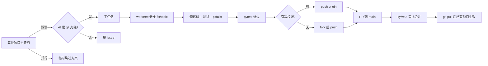

# shortcuts-kit 设计：开源 + Skill 化 + 上游回流

- 日期：2026-10-26
- 状态：已确认
- 仓库：[kylwao/shortcuts-kit](https://github.com/kylwao/shortcuts-kit)

## 1. 目标

1. 把本地稳定运行的 `ShortcutsSrc`（`shortcuts-src` 命令行工具）精简成独立公开仓库。
2. 封装成跨 AI 工具的 Agent Skill，让任何项目都能在 AI 帮助下快速开发 Apple 快捷指令。
3. 其他项目踩坑时，能以子任务的形式直接修复本仓库并提交 PR，由维护者审批合并，持续迭代。

## 2. 决策

| 议题 | 决策 |
| --- | --- |
| 发布范围 | 工具 + Skill + `examples/FoodAnalysis`（仅 V0.7） |
| 目标 AI 工具 | 通用 `SKILL.md`；主要使用 Cursor、Claude Code、WorkBuddy |
| 新快捷指令存放 | 各自独立项目；本仓库只提供工具和 Skill |
| 打包方式 | 工具和 Skill 同仓库，Skill 是薄封装；工具通过启动脚本直接运行克隆里的 `src/`（`git pull` 即升级） |
| Python 版本 | `>=3.7`（3.7.9 本地实测 45 个测试通过） |
| 回流方式 | 子任务在 kit 仓库 worktree 里修复并提 PR，而不只是提 issue |
| 审批 | 所有改动经 PR 进入 `main`；开源后要求 Code Owner（@kylwao）批准 |

## 3. 仓库结构

```text
shortcuts-kit/
├── README.md  LICENSE  CHANGELOG.md  CONTRIBUTING.md  AGENTS.md
├── pyproject.toml  .gitignore
├── src/shortcuts_src/            # 零第三方运行时依赖
├── tests/                        # 默认全部运行，含 examples 回归
├── skills/apple-shortcuts/
│   ├── SKILL.md
│   ├── references/{rules,format,pitfalls,contributing-upstream}.md
│   └── templates/
├── docs/SHORTCUTS_DEVELOPMENT.md # 人类手册
├── docs/superpowers/specs/       # 设计文档
├── examples/FoodAnalysis/
├── scripts/install.sh
└── .github/{workflows/ci.yml, CODEOWNERS, pull_request_template.md, ISSUE_TEMPLATE/}
```

## 4. 使用流程

1. 安装：`git clone` 后运行 `scripts/install.sh`。它会在 `~/.local/bin` 生成 `shortcuts-src` 启动脚本（`PYTHONPATH=<kit>/src python3 -m shortcuts_src.cli`），并把 `skills/apple-shortcuts` 软链接到各 AI 工具的 skills 目录。不用 pip editable 安装的原因：维护者本机 pip 20.1 不支持纯 `pyproject.toml` 项目的 editable 安装，而启动脚本对任何 Python 3.7+ 都可用。
2. Skill 自检：先确认 `shortcuts-src --version` 可运行；再用 realpath 解析 Skill 目录，向上两级得到 kit 根目录，判断它是不是 git 仓库，决定能否直接回流修复。
3. 开发新快捷指令有两个起点：
   - 推荐：在 Shortcuts.app 搭骨架，分享出 iCloud 链接，再 `decompile`；
   - 或者从 `templates/` 起步。
4. 循环：读 `flow.md`，局部改 `source.json`，用 `compile` 验证，更新 `VERSIONS.md`；真机调试用 `--profile dev` 加 `ingest-logs`。

## 5. 上游回流



- 触发条件：工具缺陷、平台行为坑会触发；只和当前项目业务逻辑有关的问题不触发。
- 隐私红线：提交内容不得带入原项目的私人提示词、路径、iCloud ID、token；复现片段必须先脱敏。
- 并发安全：每个修复一个 worktree，绝不直接改 `main`。
- 平台适配：Cursor 用 Task 子代理，Claude Code 用 subagent；不支持子代理的工具在同一会话中顺序执行。

### 审批阶段

| 阶段 | `main` 分支保护 |
| --- | --- |
| 一：仅维护者 | 必须走 PR，CI 必须通过；维护者自行合并 |
| 二：开放协作 | 再加至少 1 个批准且必须来自 Code Owner |

两个阶段的 Skill 和文档完全相同，切换时只改 GitHub 设置。

## 6. 不在本次范围

- Cursor 和 Claude Code 插件化。
- `shortcuts-src check` 校验命令（UUID 唯一、控制流配对），留作第一次回流的实战题目。

## 7. 待验证

- WorkBuddy 会扫描 `~/.workbuddy/skills/`（已从其 skill 缓存确认），但它是否跟随软链接，还要在 WorkBuddy 界面里确认。
- 维护者本机未安装 `gh`；在装好之前，回流流程走「push 分支后手动开 PR」的降级路径。
